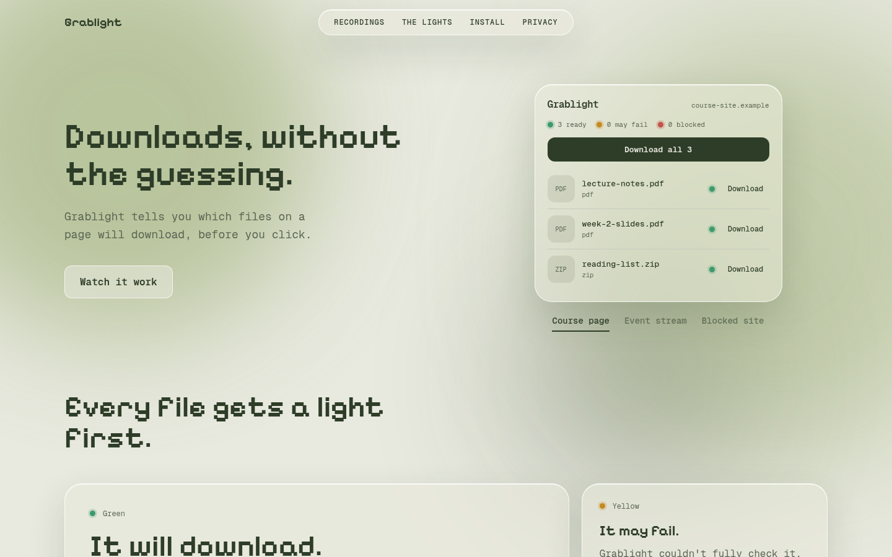
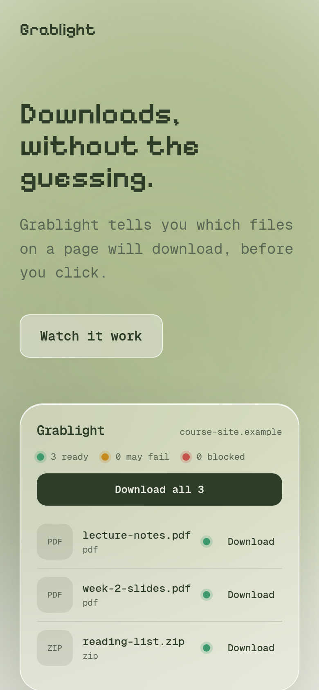

# Grablight

A Chrome extension that finds the files and videos on the page you're on and downloads them in one click, without copying links.

Before you click, every file gets a light: green means it will download, yellow means it may fail, and red means it can't (with the reason). The toolbar icon shows the same light for the whole page.

## The website

<p>
  
  
</p>

## Folders

- `extension/` — the extension (WXT + React + Tailwind, plain JavaScript)
- `website/` — the companion Next.js site (`cd website && npm install && npm run dev`, opens at http://localhost:3001)

## Run it locally

Requires Node.js 20 or newer and Chrome 116 or newer.

```bash
cd extension
npm install
npm run dev
```

`npm run dev` starts a dev server on port 3000 (it only feeds live reloads to the extension and has no page of its own) and opens a separate Chrome window with Grablight loaded, if it can find Chrome. Otherwise load `extension/.output/chrome-mv3-dev` as an unpacked extension (steps below). Edit any file and the extension reloads on its own.

To load it in your normal Chrome instead:

```bash
npm run build
```

Then open `chrome://extensions`, turn on **Developer mode**, click **Load unpacked**, and pick `extension/.output/chrome-mv3`. The folder starts with a dot: press Ctrl+H in the file picker to see it, or paste the path with Ctrl+L.

## Put the website online (Vercel)

1. Push this repo to GitHub, then on vercel.com choose **Add New → Project** and import it.
2. Set **Root Directory** to `website`. Vercel detects Next.js by itself; leave the build settings alone.
3. Click **Deploy**. Every later `git push` to `main` redeploys the site.

The install steps on the site tell visitors to `git clone` this repo, so make the repository public before sharing the link.

## What it does

- Finds files, images, audio and video on the page, plus videos the page never lists (by watching network responses).
- Gives each one a light with the reason. Checks the file's headers and, for streams, the playlist.
- Popup tabs: **Files**, **Downloads** (live progress, pause, stop, show, delete) and **History**.
- A Download button over any video or large image you hover, with its light. If the page doesn't say which file a video plays (e.g. `blob:` players) and several are found, the light is yellow, not green. Turn it off in Settings.
- Hovering the toolbar icon lists what was found, e.g. "3 images, 1 video".
- Streams with several qualities open a quality picker in the popup, with an estimated size per quality. Choose a default in Settings.
- HLS video streams (`.m3u8`), including AES-128 encryption, are joined into one `.ts` (or `.mp4`) file, including byte-range playlists. When the sound is a separate track (TS, bare `.aac` or `.mp3`, or fMP4 pieces) it is joined into the video; if it can't be, the row turns amber and the download says it has no sound. Pieces wait in the browser's private disk storage, so a stream can be larger than memory.
- Playlists named `master.m3u8` show their folder (`show-2/master.m3u8`) so several in one list can be told apart.
- Settings: hide the video button, default stream quality, sites to never take video or audio from.
- Design: `extension/DESIGN.md` describes the dark popup and settings look; the colours and fonts live in `extension/utils/theme.css`.

## What it refuses or can't do

- Video and audio from YouTube, Netflix, Prime Video, Disney+, Hotstar and Spotify (edit `BLOCKED` in `extension/utils/light.js`).
- DRM-protected streams, live streams and DASH (`.mpd`).
- Streams are saved as the raw joined pieces, with no conversion to a clean `.mp4`. The size limit is a third of the browser's free storage quota, at most 40 GB. Sound that is packed differently from its video (TS with fMP4) or is packed AC-3 is saved without sound (the popup says so).

## Checks

```bash
cd extension
for t in utils/*.test.js; do node $t; done
```

These cover the light rules, HLS parsing, decryption, stopping and retries, joining sound into video, and the page scanner. They use `console.assert`, which prints a message on failure but does not stop the run, so read the output. The popup, the on-video button and the settings page have no automated tests: try them in Chrome.

## Status

- [x] Phase 1: project setup, popup and background script
- [x] Phase 2: page scanning
- [x] Phase 3: one-click download
- [x] Phase 4: network sniffing, headers, block list, status badge
- [x] Phase 5: buttons over videos
- [x] Phase 6: HLS streams with encryption
- [x] Phase 7: site adapters (`extension/utils/scan.js`: add a site by adding one object to `ADAPTERS`)
- [x] Phase 8: history, settings and website

## License

MIT. See [LICENSE](LICENSE).
